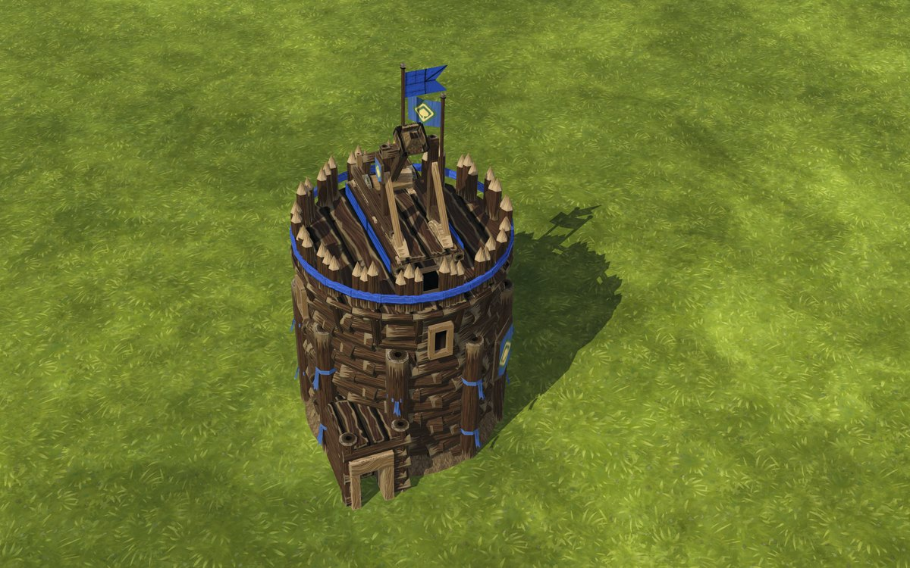
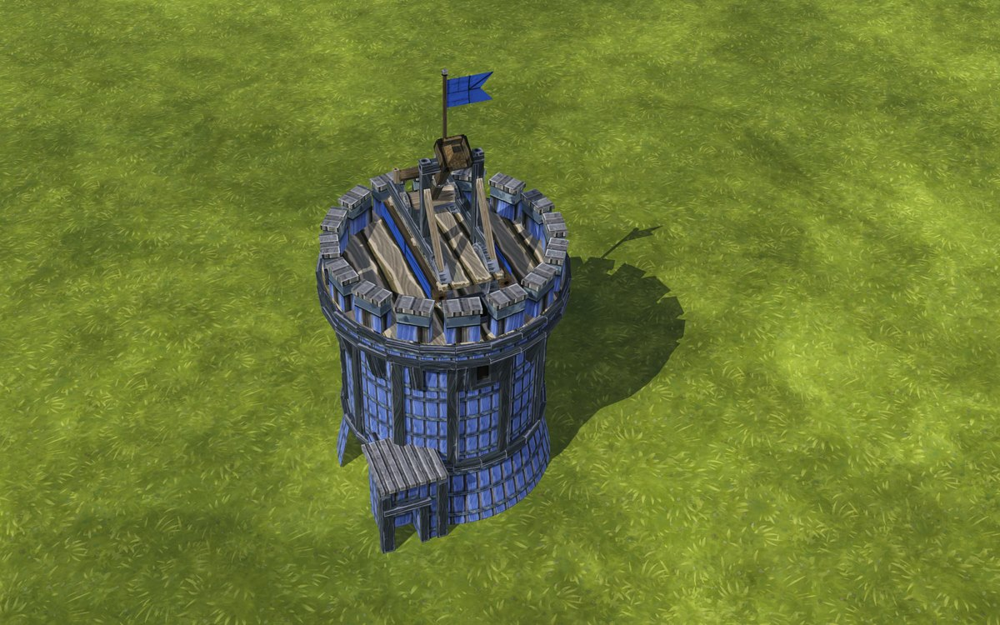
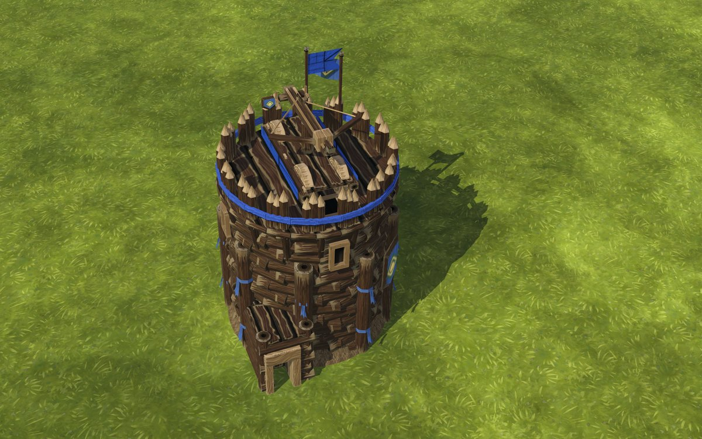
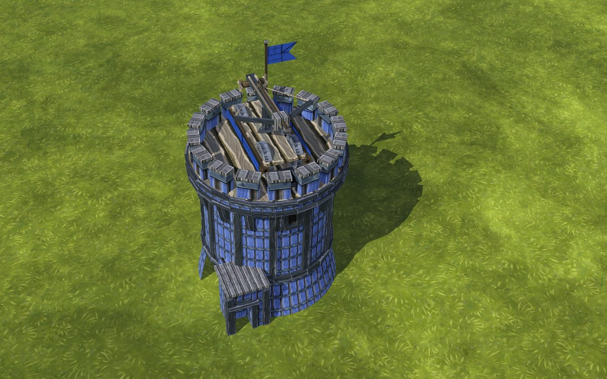
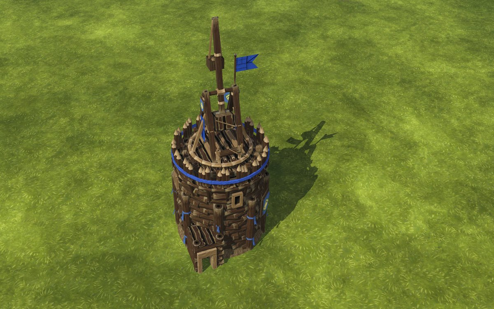
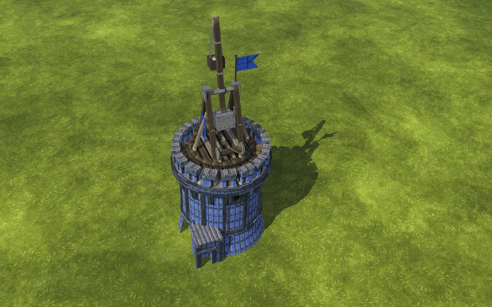

# Round Tower



A tall tower to put a [Catapult](catapult.md), [Ballista](ballista.md) or [Trebuchet](trebuchet.md) on. One machine fits on its top and stays there. With a crew aboard it shoots the nearest enemy in reach on its own; select it and click anywhere in its range to aim it yourself.

Walls join it only at the middle of a side.

| | Folktails | Iron Teeth |
|---|---|---|
| Catapult |  |  |
| Ballista |  |  |
| Trebuchet |  |  |


